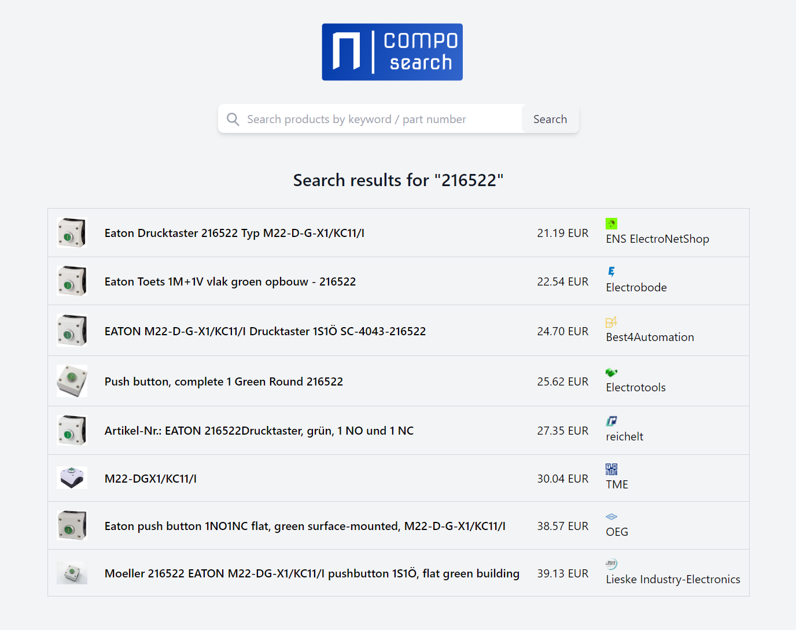

# Composearch

Composearch is a price comparison web app that combines the functionalities of a web scraper and a meta search engine. It allows you to search for products using either a product code or a keyword. Composearch utilizes its integrated web scraping capabilities to crawl and extract data from a predefined list of online stores. The application then presents the search results in a user-friendly table format, sorted by price for convenient comparison.



You can see it up and running, deployed on Railway: https://composearch.up.railway.app

## Technologies Used

- **Python**: Powers the backend functionality of Composearch.
- **Django**: Provides a robust framework for building the web application.
- **Django Channels**: Streams search results to the browser via Server-Sent Events.
- **PostgreSQL**: Stores and manages distributor data, integrated via psycopg 3.
- **Playwright**: Enables efficient web scraping and data extraction from online stores.
- **BeautifulSoup**: Facilitates HTML parsing and data extraction from web pages.
- **Redis**: Implements cache-aside (lazy loading) strategy for improved performance and serves as the Celery broker.
- **Celery**: Runs background tasks to keep the top search queries up to date.
- **TailwindCSS**: Enhances the visual aesthetics and responsiveness of the application.
- **Poetry**: Manages the project's dependencies and package management.

## Test Coverage Report

| Name | Stmts | Miss | Cover |
|------|-------|------|-------|
| composearch\\_\_init\_\_.py | 2 | 0 | 100% |
| composearch\celery.py | 7 | 0 | 100% |
| composearch\settings.py | 38 | 4 | 89% |
| composearch\urls.py | 3 | 0 | 100% |
| search\\_\_init\_\_.py | 0 | 0 | 100% |
| search\admin.py | 11 | 2 | 82% |
| search\apps.py | 4 | 0 | 100% |
| search\consumers.py | 23 | 0 | 100% |
| search\migrations\0001_initial.py | 5 | 0 | 100% |
| search\migrations\0002_distributorsourcemodel_product_currency_selector.py | 4 | 0 | 100% |
| search\migrations\0003_remove_distributorsourcemodel_product_currency_selector_and_more.py | 4 | 0 | 100% |
| search\migrations\0004_distributorsourcemodel_active.py | 4 | 0 | 100% |
| search\migrations\0005_remove_distributorsourcemodel_including_vat_and_more.py | 4 | 0 | 100% |
| search\migrations\\_\_init\_\_.py | 0 | 0 | 100% |
| search\models.py | 14 | 0 | 100% |
| search\parsers\\_\_init\_\_.py | 4 | 0 | 100% |
| search\parsers\base.py | 40 | 8 | 80% |
| search\parsers\bs4_parser.py | 27 | 0 | 100% |
| search\parsers\playwright_parser.py | 31 | 2 | 94% |
| search\services\\_\_init\_\_.py | 5 | 0 | 100% |
| search\services\fetcher.py | 38 | 0 | 100% |
| search\services\product.py | 55 | 0 | 100% |
| search\services\search_service.py | 38 | 0 | 100% |
| search\services\stats.py | 40 | 10 | 75% |
| search\tasks.py | 8 | 0 | 100% |
| search\tests\\_\_init\_\_.py | 0 | 0 | 100% |
| search\tests\fixtures\playwright.py | 47 | 4 | 91% |
| search\tests\fixtures\products.py | 5 | 0 | 100% |
| search\tests\parsers\\_\_init\_\_.py | 0 | 0 | 100% |
| search\tests\parsers\test_base.py | 19 | 1 | 95% |
| search\tests\parsers\test_bs4_parser.py | 35 | 0 | 100% |
| search\tests\parsers\test_playwright_parser.py | 35 | 0 | 100% |
| search\tests\services\\_\_init\_\_.py | 0 | 0 | 100% |
| search\tests\services\test_fetcher.py | 29 | 0 | 100% |
| search\tests\services\test_perform_search.py | 16 | 0 | 100% |
| search\tests\services\test_product.py | 40 | 0 | 100% |
| search\tests\services\test_stats.py | 49 | 0 | 100% |
| search\tests\services\test_stream_search.py | 47 | 0 | 100% |
| search\tests\test_consumers.py | 45 | 0 | 100% |
| search\tests\test_distributors.py | 9 | 0 | 100% |
| search\tests\test_models.py | 48 | 0 | 100% |
| search\tests\test_tasks.py | 15 | 0 | 100% |
| search\tests\test_views.py | 42 | 0 | 100% |
| search\tests\utils\\_\_init\_\_.py | 0 | 0 | 100% |
| search\tests\utils\test_helpers.py | 15 | 0 | 100% |
| search\urls.py | 3 | 0 | 100% |
| search\utils\\_\_init\_\_.py | 2 | 0 | 100% |
| search\utils\helpers.py | 10 | 0 | 100% |
| search\views.py | 14 | 0 | 100% |
| **TOTAL** | **934** | **31** | **97%** |

## Quick Start

##### Prerequisites

- Python 3.11.5+
- Poetry
- Redis (optional)
- PostgreSQL (optional)

##### 1. Checkout the project from github

```
git checkout https://github.com/enev13/composearch.git
```

##### 2. Rename .env.sample file in the project folder to .env and edit the environment variables if necessary.

```
mv .env.sample .env
nano .env
```

##### 3. Install the project dependencies

```
poetry install
```

##### 4. Initialize Playwright (it will install Chromium and other dependencies)

```
playwright install --with-deps chromium
```

##### 5. Initialize the Django app

```
python manage.py migrate
python manage.py collectstatic
python manage.py createsuperuser
uvicorn composearch.asgi:application --reload
```

##### 6. Fill in some Distributor data

by either creating new database entries using Django admin

```
http://127.0.0.1:8000/admin
```

or by loading the supplied fixtures file
```
python manage.py loaddata distributors.json
```

(See more details below about the Distributor data format.)

`loaddata` is only for the initial seeding of an empty database. If you later edit the fixture (add, remove or update distributors), keep the database in sync with the `sync_distributors` command instead of re-running `loaddata`, which would create duplicate entries:

```
python manage.py sync_distributors
```

(See more details below about keeping the distributor list in sync.)

##### 7. Open Composearch in your web browser

```
http://127.0.0.1:8000/
```

## The DistributorSourceModel

In order to have a fully functional app, the database must be populated with distributor data.
For each online store following data is needed:

- name - name of the distributor, e.g. _BestParts_
- base_url - base url with trailing slash, e.g. *https://www.bestparts.com/*
- search_string - the rest of the search address, e.g. *search?q=%s* , where %s is in the place of the search term
- currency - the currency in which the distributor's site operate, e.g. EUR, USD, GBP, etc.
- included_vat - the VAT percentage included in the price. Used to calculate the net price, which will be displayed
- product_name_selector - CSS selector for the product name in the search results
- product_url_selector - CSS selector for the product url in the search results
- product_picture_url_selector - CSS selector for the ulr of the product picture in the search results
- product_price_selector - CSS selector for the product price in the search results
- active - indicates whether this distributor will be used in the searches
- probe_query - search term used by the health probes to test the distributor's selectors; falls back to the default probe query if omitted

## Keeping the distributor list in sync

`search/fixtures/distributors.json` is the canonical, version-controlled list of distributors. The `sync_distributors` management command updates the database to match it:

```
python manage.py sync_distributors                   # dry run: prints the planned changes only
python manage.py sync_distributors --apply           # create and update rows to match the fixture
python manage.py sync_distributors --apply --prune   # also deactivate rows missing from the fixture
```

- Distributors are matched by `name`; their definition fields (`base_url`, `search_string`, `currency`, `included_vat`, the CSS selectors and `probe_query`) are updated to match the fixture.
- Existing rows keep their `active` flag and their `DistributorStats` — manual activation/deactivation decisions and recorded statistics are never overwritten. Rows newly created by the sync take the `active` value from the fixture.
- `--prune` deactivates distributors missing from the fixture but never deletes them, so their statistics survive.
- After syncing, re-evaluate the health of the changed distributors from the Django admin (*Test now* action) or by running the `probe_distributors` task.

## Project Evolution / Next Steps

This is how the project evolved since the beginning:
- [x] Create a MVP using requests to get the HTML data and BeautifulSoup to parse it
- [x] Replace requests library with aiohttp to be able to load pages simultaneously/asynchronously
- [x] Use TailwindCSS to improve templates aesthetics
- [x] Experiment with using MongoDB Atlas instead of SQLite (using Djongo/PyMongo)
- [x] Drop aiohttp and use Playwright to be able to also get the dynamic content many pages have
- [x] Add lazy-load caching of pages using Redis
- [x] Migrate to PostreSQL for main database (using psycopg 3 driver)
- [x] Experiment with using Playwright also as parser instead of BeautifulSoup
- [x] Refactor html page parsing for decoupling from the concrete parser library and keep BeautifulSoup as default parser
- [x] Adjust project dependencies for deployment in Railway.app
- [x] Add Github Actions workflow

And these are the currently planned steps in its development:
- [x] Dockerize the project
- [x] Add intermediate "Loading" page for better user experience
- [x] Replace the "Loading" page with dynamic search results loading using Django Channels
- [x] Keep statistic of the top 100 most used search queries and use Celery to keep them up-to-date in cache


## Further Reading

- Playwright Documentation: https://playwright.dev/python/docs/intro
- BeautifulSoup Documentation: https://www.crummy.com/software/BeautifulSoup/bs4/doc/
- How to Use CSS Selectors: https://www.w3schools.com/cssref/css_selectors.php
- Using Caching in Django: https://docs.djangoproject.com/en/5.2/topics/cache/#basic-usage

## License

Composearch is released under the [MIT License](/LICENSE). Feel free to use, modify, and distribute the code as per the terms.
